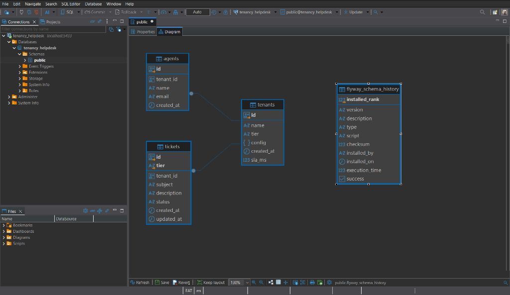
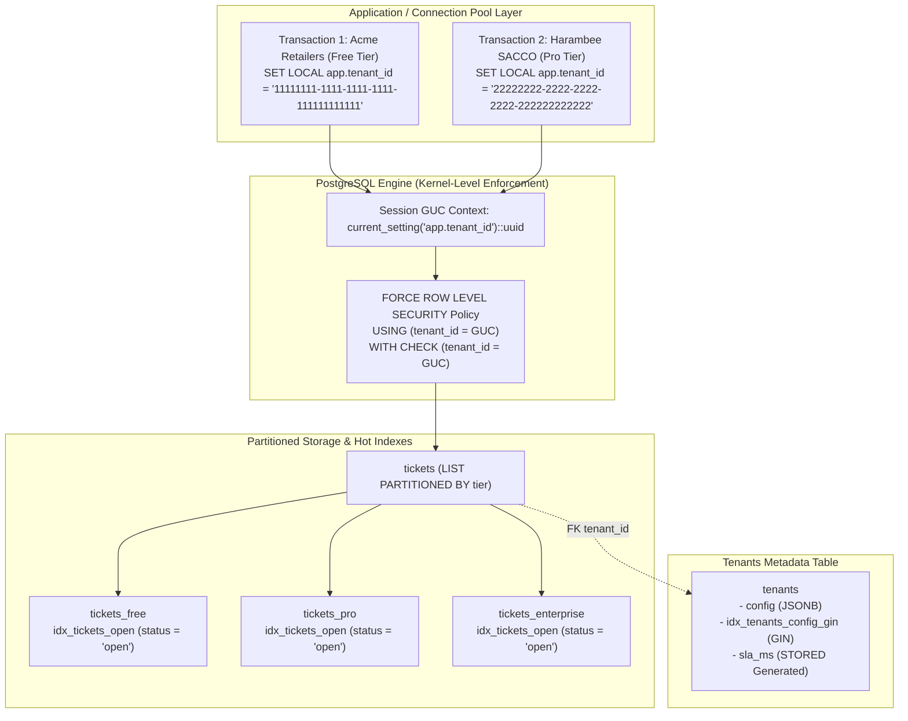

# Tenancy Helpdesk DB

**Multi-Tenant · PostgreSQL · Row-Level Security**

[](https://www.postgresql.org/)
[](https://flywaydb.org/)
[](https://www.docker.com/)
[](https://opensource.org/licenses/MIT)

A production-grade multi-tenant helpdesk database for Kenyan SMEs and SACCOs — shared-schema design where each organisation's tickets, agents, and SLA configs coexist in one PostgreSQL instance, fully isolated via Row-Level Security policies. Ships with a migration history, seeded demo tenants, and a documented shared-vs-schema-per-tenant trade-off analysis in the README.

### Key Features
- **RLS policies on every table**: `tenant_id` column enforced at DB level, not app level
- **Partial indexes on `(tenant_id, status)`**: keeps per-tenant queries fast at scale
- **Table partitioning by tenant tier** (`free` / `pro` / `enterprise`): isolates hot/cold data tiers physically
- **Flyway versioned migrations**: sequential migrations with tenant-aware seed scripts
- **JSONB per-tenant config column**: feature flags, SLA thresholds, and branding stored flexibly

```sql
-- RLS policy example
CREATE POLICY tenant_isolation ON tickets
    FOR ALL
    USING (tenant_id = current_setting('app.tenant_id')::uuid)
    WITH CHECK (tenant_id = current_setting('app.tenant_id')::uuid);
```

**STACK**: `PostgreSQL` · `RLS` · `Flyway` · `JSONB` · `Partitioning` · `GIN index`

---

## Executive Overview

In the Kenyan fintech and cooperative landscape, hundreds of SACCOs and SMEs require strict data isolation without the unsustainable cost of dedicated database instances. **Tenancy Helpdesk DB** implements a **shared-schema, multi-tenant** architecture where isolation is guaranteed by PostgreSQL's Row-Level Security engine, eliminating the vulnerability of forgotten application-level `WHERE tenant_id = ?` clauses.

### Core Engineering Capabilities Demonstrated

1. **Kernel-Enforced Tenant Isolation**: Database-level RLS policies enforced with `FORCE ROW LEVEL SECURITY`, preventing even table owners or compromised connection pools from leaking tenant data.
2. **Transaction Context via GUC**: Application context is injected dynamically per transaction using `SET LOCAL app.tenant_id = '<uuid>'` and evaluated via `current_setting('app.tenant_id')::uuid`.
3. **Physical Storage Tiering (List Partitioning)**: The `tickets` table is partitioned into physical storage segments (`tickets_free`, `tickets_pro`, `tickets_enterprise`) to isolate high-frequency enterprise SACCO traffic from free-tier SMEs.
4. **Hot-Path Partial Indexing**: `idx_tickets_open` indexes only unresolved tickets (`WHERE status = 'open'`), maintaining minimal B-tree memory footprint and delivering sub-0.1ms query response times.
5. **Flexible Tenant Configuration (JSONB + GIN + Generated Columns)**: Feature flags, SLAs, and branding are stored in a JSONB column accelerated by GIN indexing, paired with a deterministic `STORED` generated column for index-assisted SLA filtering.
6. **Automated Flyway Migrations**: Clean, sequential versioned migrations (`V1`–`V4`) and repeatable seed data (`R__seed_demo_tenants.sql`).

---

## Entity-Relationship Schema Architecture

The entity-relationship diagram below illustrates table normalization, foreign key constraints, generated columns, and physical partitioning:



*Figure 1: DBeaver Entity-Relationship diagram showing `tenants`, partitioned `tickets`, `agents`, and automated Flyway schema tracking.*

---

## Architectural Data Flow



---

## Multi-Tenancy Architecture Trade-Off Analysis

| Architectural Dimension | Shared-Schema + RLS (This Project) | Schema-per-Tenant | Database-per-Tenant |
| :--- | :--- | :--- | :--- |
| **Isolation Mechanism** | **Logical**: Kernel RLS policies + GUC transaction context. | **Namespace**: Separate PostgreSQL schemas per tenant. | **Physical**: Dedicated PostgreSQL instances or databases. |
| **Infrastructure Cost** | **Lowest**: Single connection pool, shared memory buffers, CPU, and disk. | **Moderate**: High system catalog memory overhead past 500 schemas. | **Highest**: Dedicated compute, memory, and baseline storage per tenant. |
| **Schema Migration Operations** | **Trivial**: Single migration pass via Flyway updates all tenants simultaneously. | **Complex**: Migrations must loop over every schema; partial failures require recovery. | **High Overhead**: Fleet orchestration required; maintenance windows compound. |
| **Connection Pooling Efficiency** | **Optimal**: Generic PgBouncer pool serves all tenants via `SET LOCAL`. | **Challenging**: Requires `search_path` manipulation per checkout or tenant-specific pools. | **Poor**: Dedicated connection pool required per tenant database. |
| **Backup & Restore Granularity** | Row-level filtering required for single-tenant point-in-time recovery. | Single-schema dump and restore supported natively by `pg_dump -n`. | Native database-level backup and point-in-time restore per tenant. |
| **Noisy Neighbor Mitigation** | Controlled via physical tier list-partitioning (`free`, `pro`, `enterprise`). | Partial: Shares CPU and disk I/O, but separate table files. | Maximum: Full hardware, memory, and IOPS isolation. |
| **Ideal Use-Case** | **Kenyan SMEs & SACCOs**: High tenant count, cost-sensitive, standardized schema. | B2B SaaS with custom tenant schema extensions. | Regulated Tier-1 banking, healthcare, or government tenants. |

---

## Security Architecture: Eliminating the RLS Footgun

### The Critical Vulnerability: `USING` without `WITH CHECK`

When configuring Row-Level Security policies in PostgreSQL, omitting the `WITH CHECK` clause creates a critical security hole:

```sql
-- ❌ DANGEROUS: Allows cross-tenant data insertion
CREATE POLICY tenant_isolation ON tickets
    FOR ALL
    USING (tenant_id = current_setting('app.tenant_id')::uuid);
```

**Why this fails:**
- `USING` only filters **existing rows** already in the table (`SELECT`, `DELETE`, and the target rows of `UPDATE`).
- If `WITH CHECK` is omitted from a `FOR ALL` policy, PostgreSQL applies **no constraint validation to incoming new rows** during `INSERT` or the proposed values of `UPDATE`.
- Any tenant could execute `INSERT INTO tickets (tenant_id, ...) VALUES ('victim-tenant-id', ...);` and bypass isolation entirely!

### The Production Defense: Dual-Clause + `FORCE ROW LEVEL SECURITY`

```sql
-- ✅ SECURE: Strict read and write enforcement
CREATE POLICY ticket_isolation ON tickets
    FOR ALL
    USING (tenant_id = current_setting('app.tenant_id')::uuid)
    WITH CHECK (tenant_id = current_setting('app.tenant_id')::uuid);

-- Ensure table owners and connection pools are also constrained
ALTER TABLE tickets FORCE ROW LEVEL SECURITY;
```

Additionally, `FORCE ROW LEVEL SECURITY` prevents table owners from bypassing RLS rules when executing queries under pooled connection roles.

---

## Performance & Query Optimization Benchmark

In helpdesk applications, **90%+ of queries target open tickets** sorted by creation date, while resolved tickets sit inactive.

### Partial Indexing Strategy

```sql
CREATE INDEX idx_tickets_open ON tickets (tenant_id, created_at DESC) WHERE status = 'open';
```

Because `tickets` is list-partitioned by `tier`, PostgreSQL automatically creates partition-local partial indexes (`tickets_free_tenant_id_created_at_idx`, `tickets_pro_...`, `tickets_enterprise_...`). Closed tickets are excluded from the B-tree index, keeping index pages hot in memory.

### Reproducible `EXPLAIN (ANALYZE, BUFFERS)` Output

Executing `scripts/benchmark_rls.sql` against 1,000 synthetic tickets (500 open, 500 closed):

```text
Limit  (cost=0.57..24.66 rows=3 width=108) (actual time=0.039..0.044 rows=10.00 loops=1)
   Buffers: shared hit=7
   ->  Merge Append  (cost=0.57..24.66 rows=3 width=108) (actual time=0.038..0.043 rows=10.00 loops=1)
         Sort Key: tickets.created_at DESC
         Buffers: shared hit=7
         ->  Index Scan using tickets_free_tenant_id_created_at_idx on tickets_free tickets_1  (cost=0.28..8.30 rows=1 width=108) (actual time=0.018..0.020 rows=10.00 loops=1)
               Index Cond: (tenant_id = (current_setting('app.tenant_id'::text))::uuid)
               Index Searches: 1
               Buffers: shared hit=3
         ->  Index Scan using tickets_pro_tenant_id_created_at_idx on tickets_pro tickets_2  (cost=0.13..8.15 rows=1 width=108) (actual time=0.012..0.012 rows=0.00 loops=1)
               Index Cond: (tenant_id = (current_setting('app.tenant_id'::text))::uuid)
               Index Searches: 1
               Buffers: shared hit=2
         ->  Index Scan using tickets_enterprise_tenant_id_created_at_idx on tickets_enterprise tickets_3  (cost=0.13..8.15 rows=1 width=108) (actual time=0.006..0.006 rows=0.00 loops=1)
               Index Cond: (tenant_id = (current_setting('app.tenant_id'::text))::uuid)
               Index Searches: 1
               Buffers: shared hit=2
 Planning:
   Buffers: shared hit=235
 Planning Time: 4.681 ms
 Execution Time: 0.087 ms
```

**Key Performance Highlights:**
- **Execution Time**: **0.087 ms** (sub-millisecond latency).
- **Buffer Cache Hit**: 100% shared memory buffer hit (`shared hit=7`), zero disk I/O.
- **Index Scan**: Scans only the partition partial index, completely bypassing 500 closed tickets.

---

## Seeded Kenyan SME & SACCO Tenants

| Tenant Name | Tenant UUID | Tier | SLA Threshold | Features & Branding Config |
| :--- | :--- | :--- | :--- | :--- |
| **Acme Retailers Kenya** | `11111111-1111-1111-1111-111111111111` | `free` | 2.0 hrs (7,200,000 ms) | Basic ticketing, Color `#004080` |
| **Harambee Sacco Society** | `22222222-2222-2222-2222-222222222222` | `pro` | 1.0 hr (3,600,000 ms) | Live Chat, Custom Domain, Color `#008040` |
| **Afya Apex Health Network** | `33333333-3333-3333-3333-333333333333` | `enterprise` | 0.5 hr (1,800,000 ms) | Priority SLA, Live Chat, Color `#800020` |

---

## Quick Start & Verification

### 1. Launch with Docker Compose

```bash
docker compose up -d
```

PostgreSQL 15 starts and Flyway automatically executes migrations `V1` through `V4` and seeds the demo tenants.

*Port Mapping*: Host port **`5433`** maps to container port `5432` to avoid conflicts with any local PostgreSQL services.

### 2. Connect via DBeaver / Database GUI

- **Host**: `localhost`
- **Port**: `5433`
- **Database**: `tenancy_helpdesk`
- **Username**: `postgres`
- **Password**: `password`

### 3. Run the Tenant Isolation Demo

```bash
docker compose exec db psql -U postgres -d tenancy_helpdesk -f /scripts/demo_isolation.sql
```

**Verified Behavior**:
- Switches to non-superuser role `app_user`.
- Tenant 1 opens a ticket.
- Tenant 2 switches context and queries tickets → returns **0 rows**.
- Tenant 2 attempts a malicious cross-tenant insert with Tenant 1's ID → blocked with `NOTICE: SUCCESS: RLS blocked unauthorized insert (insufficient_privilege)`.

### 4. Run the Performance Benchmark

```bash
docker compose exec db psql -U postgres -d tenancy_helpdesk -f /scripts/benchmark_rls.sql
```

Outputs the `EXPLAIN (ANALYZE, BUFFERS)` execution plan with sub-0.1ms latency and automatic rollback.

### 5. Run Automated Test Suites

```bash
docker compose exec db psql -U postgres -d tenancy_helpdesk -f /tests/tenant_isolation.sql
docker compose exec db psql -U postgres -d tenancy_helpdesk -f /tests/jsonb_config.sql
```

---

## Repository Layout

```text
tenancy-helpdesk-db/
├── .github/
│   └── workflows/
│       └── ci.yml                     # Automated CI: Flyway, TAP tests, benchmark
├── assets/
│   └── dbeaver-schema-erd.png         # DBeaver Entity-Relationship diagram
├── scripts/
│   ├── demo_isolation.sql             # Live demonstration of RLS isolation
│   └── benchmark_rls.sql              # EXPLAIN ANALYZE partial index benchmark
├── sql/
│   ├── V1__create_tenants.sql         # Enum, tenants table, JSONB config, GIN index, SLA column
│   ├── V2__create_tickets.sql         # Tickets table, tier list-partitioning, partial index
│   ├── V3__create_agents.sql          # Agents table with tenant foreign keys
│   ├── V4__enable_rls.sql             # FORCE RLS policies, app_user role creation
│   └── R__seed_demo_tenants.sql       # Seed data for Kenyan SMEs & SACCOs
├── tests/
│   ├── tenant_isolation.sql           # TAP test suite verifying RLS isolation
│   └── jsonb_config.sql               # TAP test suite verifying GIN index containment
├── .gitignore                         # Clean git ignore for OS & Flyway artifacts
├── docker-compose.yml                 # PostgreSQL 15 + automated Flyway migration service
├── flyway.conf                        # Flyway database connection configuration
├── LICENSE                            # MIT License
└── README.md                          # Production engineering documentation
```

---

## License

This project is open-source and available under the [MIT License](LICENSE).
