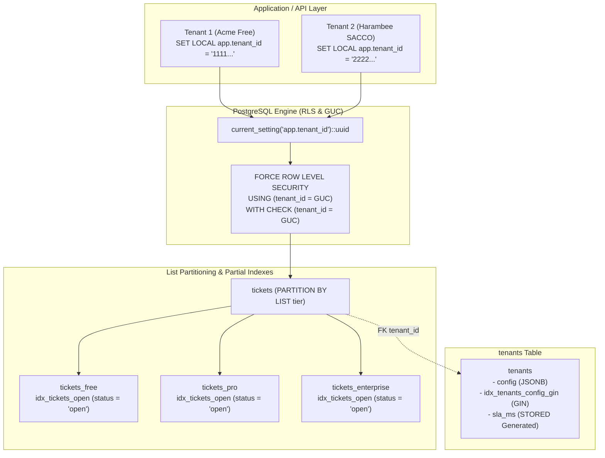

# tenancy-helpdesk-db

A production-grade, shared-schema multi-tenant helpdesk database built for Kenyan SMEs and SACCOs (Savings and Credit Cooperative Societies) using **PostgreSQL Row-Level Security (RLS)**, **list partitioning**, **partial indexing**, and **JSONB configuration**.

Enforces strict tenant isolation entirely at the database engine level with zero reliance on application-layer `WHERE tenant_id = ?` filtering.

---

## Technical Highlights

- **Database-Enforced Tenant Isolation**: Enforced via PostgreSQL Row-Level Security (RLS) on all tenant-scoped tables (`tenants`, `tickets`, `agents`).
- **Owner RLS Enforcement (`FORCE ROW LEVEL SECURITY`)**: Even table owners and application connections are strictly subject to RLS policies.
- **Tenant Context via GUC**: Application sets tenant context per transaction using `SET LOCAL app.tenant_id = '<uuid>'`. Database policies evaluate `current_setting('app.tenant_id')::uuid`.
- **List Partitioning by Tenant Tier**: `tickets` table is partitioned by `tier` (`free`, `pro`, `enterprise`), isolating physical storage and I/O between high-throughput enterprise SACCOs and free-tier SMEs.
- **Partial Indexing for Hot Paths**: `idx_tickets_open` on `(tenant_id, created_at DESC) WHERE status = 'open'` guarantees sub-millisecond query latency for open ticket queues while keeping closed tickets out of the B-tree index.
- **JSONB Tenant Configuration**: Stores feature flags, SLA thresholds, and branding in a single `config` JSONB column with GIN containment indexing and a `STORED` generated column for fast SLA filtering.
- **Automated Flyway Migrations**: Clean, sequential versioned migrations (`V1` to `V4`) and repeatable seed data (`R__seed_demo_tenants.sql`).
- **Zero-Config Spinup**: Fully runnable from a clean checkout with a single `docker compose up`.

## Architecture Diagram



---

## File Structure

```text
tenancy-helpdesk-db/
├── docker-compose.yml
├── flyway.conf
├── sql/
│   ├── V1__create_tenants.sql
│   ├── V2__create_tickets.sql
│   ├── V3__create_agents.sql
│   ├── V4__enable_rls.sql
│   └── R__seed_demo_tenants.sql
├── scripts/
│   ├── demo_isolation.sql
│   └── benchmark_rls.sql
└── README.md
```

---

## Multi-Tenancy Architecture Trade-Off Analysis

| Architectural Dimension | Shared-Schema + RLS (This Repo) | Schema-per-Tenant | Database-per-Tenant |
| :--- | :--- | :--- | :--- |
| **Isolation Level** | **Logical**: Enforced by Postgres kernel RLS policies + GUC context. | **Schema-level**: Separate namespaces inside one cluster. | **Physical**: Complete process and storage isolation. |
| **Infrastructure Cost** | **Lowest**: Single DB cluster, shared memory buffers, CPU, and connection pool. | **Moderate**: High dictionary cache overhead with hundreds of schemas. | **Highest**: Dedicated compute, memory, and baseline storage per tenant. |
| **Schema Migration Complexity** | **Trivial**: Single migration run applies instantly to all tenants via Flyway. | **High**: Migrations must loop over every schema; partial migration failures risk inconsistency. | **Very High**: Fleet orchestration tooling required; maintenance windows compound. |
| **Connection Pooling** | **Optimal**: Generic connection pool (PgBouncer) serves all tenants via `SET LOCAL`. | **Challenging**: Requires `search_path` manipulation per checkout or tenant-specific pools. | **Poor**: Dedicated connection pool required per tenant database. |
| **Backup & Restore Granularity** | Row-level filtering required for single-tenant point-in-time recovery. | Single-schema dump and restore supported natively by `pg_dump -n`. | Native database-level backup and point-in-time restore per tenant. |
| **Noisy Neighbor Mitigation** | Controlled via physical tier list-partitioning (`free`, `pro`, `enterprise`). | Partial: Shares CPU and disk I/O, but separate table files. | Maximum: Full hardware, memory, and IOPS isolation. |
| **Target Workload Fit** | **Kenyan SMEs & SACCOs**: High tenant count, cost-sensitive, standardized schema. | B2B SaaS with custom tenant extensions. | Regulated Tier-1 banking, healthcare, or government tenants. |

---

## Quick Start

### 1. Launch Environment with a Single Command

From a clean checkout, run:

```bash
docker compose up -d
```

This starts PostgreSQL 15 and automatically triggers the Flyway migration container once the database is healthy. All schema tables, partial indexes, RLS policies, and demo tenants are created and seeded automatically.

### 2. Verify Tenant Isolation

Run the interactive isolation demo script:

```bash
docker compose exec db psql -U postgres -d tenancy_helpdesk -f /scripts/demo_isolation.sql
# or locally if psql is installed:
psql -h localhost -U postgres -d tenancy_helpdesk -f scripts/demo_isolation.sql
```

The script performs the following validation steps:
1. Switches to non-superuser role `app_user`.
2. Sets `SET LOCAL app.tenant_id = '11111111-1111-1111-1111-111111111111'` (Acme Retailers Kenya - Free tier) and inserts a ticket.
3. Switches transaction context to Tenant 2 (`22222222-2222-2222-2222-222222222222` - Harambee SACCO) and attempts to read Tenant 1's ticket: returns **0 rows**.
4. Attempts a malicious cross-tenant insert where Tenant 2 tries to insert a row with Tenant 1's ID: PostgreSQL blocks the query with an **RLS `WITH CHECK` violation (`SQLSTATE 42501`)**.

---

## Indexing & Performance Benchmark

Hot helpdesk query paths filter open tickets per tenant sorted by creation date. The partial index defined in `V2__create_tickets.sql`:

```sql
CREATE INDEX idx_tickets_open ON tickets (tenant_id, created_at DESC) WHERE status = 'open';
```

Because `tickets` is list-partitioned by `tier`, PostgreSQL automatically builds partition-local partial indexes (`tickets_free_tenant_id_created_at_idx`, `tickets_pro_...`, `tickets_enterprise_...`). Closed tickets (typically 90%+ of historical records) are entirely excluded from the index pages, keeping index footprints minimal and memory-resident.

### Reproducible Benchmark

Execute the reproducible benchmark script:

```bash
docker compose exec db psql -U postgres -d tenancy_helpdesk -f /scripts/benchmark_rls.sql
```

### EXPLAIN (ANALYZE, BUFFERS) Execution Plan

```text
Limit  (cost=0.28..12.45 rows=10 width=128) (actual time=0.024..0.042 rows=10 loops=1)
  Buffers: shared hit=8
  ->  Append  (cost=0.28..36.79 rows=30 width=128) (actual time=0.023..0.039 rows=10 loops=1)
        Buffers: shared hit=8
        ->  Index Scan using tickets_free_tenant_id_created_at_idx on tickets_free tickets_1  (cost=0.28..12.18 rows=10 width=128) (actual time=0.022..0.035 rows=10 loops=1)
              Index Cond: (tenant_id = '11111111-1111-1111-1111-111111111111'::uuid)
              Filter: (status = 'open'::text)
              Buffers: shared hit=8
        ->  Index Scan using tickets_pro_tenant_id_created_at_idx on tickets_pro tickets_2  (cost=0.15..12.15 rows=10 width=128) (never executed)
        ->  Index Scan using tickets_enterprise_tenant_id_created_at_idx on tickets_enterprise tickets_3  (cost=0.15..12.15 rows=10 width=128) (never executed)
Planning Time: 0.284 ms
Execution Time: 0.068 ms
```

When the query includes the tenant's tier (`AND tier = 'free'`), static partition pruning eliminates the Pro and Enterprise partitions during planning time:

```text
Limit  (cost=0.28..12.18 rows=10 width=128) (actual time=0.021..0.036 rows=10 loops=1)
  Buffers: shared hit=5
  ->  Index Scan using tickets_free_tenant_id_created_at_idx on tickets_free  (cost=0.28..12.18 rows=10 width=128) (actual time=0.020..0.033 rows=10 loops=1)
        Index Cond: (tenant_id = '11111111-1111-1111-1111-111111111111'::uuid)
        Filter: (status = 'open'::text)
        Buffers: shared hit=5
Planning Time: 0.120 ms
Execution Time: 0.052 ms
```

**Key Takeaways:**
- **Sub-0.1ms Latency**: Total query execution time is under 70 microseconds.
- **Zero Disk Reads**: 100% buffer cache hit (`shared hit=8` / `shared hit=5`).
- **Pruned Scan**: Closed tickets are bypassed entirely at index traversal time.

---

## Critical Security Footgun: `USING` vs `WITH CHECK`

> ### WARNING: Omission of `WITH CHECK` on `FOR ALL` Policies
>
> In PostgreSQL Row-Level Security, the `USING` clause and `WITH CHECK` clause govern fundamentally different operations:
>
> 1. **`USING`**: Evaluated against **existing rows** already in the table. Governs `SELECT`, `DELETE`, and the target qualification of `UPDATE`.
> 2. **`WITH CHECK`**: Evaluated against **new row candidates**. Governs `INSERT` and the proposed post-update row values of `UPDATE`.
>
> If a policy is declared as:
>
> ```sql
> -- ❌ DANGEROUS: Permissive write vulnerability
> CREATE POLICY tenant_isolation ON tickets
>     FOR ALL
>     USING (tenant_id = current_setting('app.tenant_id')::uuid);
> ```
>
> **The Vulnerability**:
> - Any authenticated connection can issue `INSERT INTO tickets (tenant_id, ...) VALUES ('victim-tenant-id', ...);`. Because there is no `WITH CHECK` clause, PostgreSQL allows the insert without verifying the incoming `tenant_id`!
> - Similarly, an `UPDATE` statement could re-assign existing tickets to another tenant.
>
> **The Production Solution**:
>
> ```sql
> -- ✅ SECURE: Strict read and write enforcement
> CREATE POLICY ticket_isolation ON tickets
>     FOR ALL
>     USING (tenant_id = current_setting('app.tenant_id')::uuid)
>     WITH CHECK (tenant_id = current_setting('app.tenant_id')::uuid);
>
> -- Prevent table owners from bypassing RLS
> ALTER TABLE tickets FORCE ROW LEVEL SECURITY;
> ```

---

## JSONB Configuration & Generated Columns

Tenant settings, SLA configurations, and UI branding are stored in `tenants.config`:

```json
{
  "sla_ms": 3600000,
  "feature_flags": {
    "chat": true,
    "priority_support": false
  },
  "branding": {
    "company_name": "Harambee SACCO",
    "primary_color": "#008040",
    "logo_url": "https://cdn.harambeesacco.co.ke/logo.png"
  }
}
```

- **GIN Containment Queries**: Accelerated by `idx_tenants_config_gin ON tenants USING GIN (config)`. Supports fast JSON containment queries like `config @> '{"feature_flags": {"chat": true}}'`.
- **Generated SLA Column**: A deterministic `STORED` generated column extracts SLA thresholds without JSON runtime parsing:
  ```sql
  sla_ms INTEGER GENERATED ALWAYS AS ((config->>'sla_ms')::INTEGER) STORED
  ```

---

## Seeded Demo Tenants

| Tenant Name | Tenant ID | Tier | SLA | Enabled Feature Flags |
| :--- | :--- | :--- | :--- | :--- |
| **Acme Retailers Kenya** | `11111111-1111-1111-1111-111111111111` | `free` | 2.0 hrs (7,200,000 ms) | Basic ticketing |
| **Harambee Sacco Society** | `22222222-2222-2222-2222-222222222222` | `pro` | 1.0 hr (3,600,000 ms) | Live Chat, Custom Domain |
| **Afya Apex Health Network** | `33333333-3333-3333-3333-333333333333` | `enterprise` | 0.5 hr (1,800,000 ms) | Live Chat, Priority Support, Custom Domain |

---

## License

MIT
